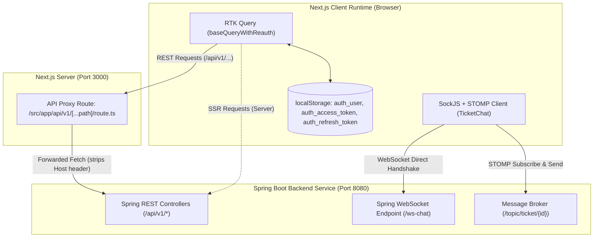

# 01. Overview & Technical Discovery

## 1. Executive Summary

This document provides a comprehensive technical overview and architecture specification of the **Helpdesk Support System** frontend web application (`helpdesk-frontend`). The purpose of this specification is to establish a rigorous, code-backed foundation for rebuilding the application as a cross-platform mobile application using **Flutter**.

The existing web application is an administrative and operations portal for a multi-role IT Helpdesk service. It supports three distinct user personas:
1. **Regular Users (`USER`)**: Submit incident tickets from categorized templates, attach screenshots/error images, view personal ticket status, review closed ticket history, and communicate in real-time with technicians.
2. **Technicians (`TECHNICIAN`)**: View incident metrics and monthly ticket volume trends, inspect all organization tickets, accept pending tickets (transitioning them to `IN_PROGRESS`), close resolved tickets (`COMPLETED`), chat with users via WebSockets, view ticket history, and manage incident categories.
3. **Administrators (`ADMIN`)**: Access all technician capabilities, plus full **User Management** (create, edit, delete users, assign departments and roles) and **Department Management** (create organizational departments).

---

## 2. Web Application Tech Stack

| Layer / Concern | Technology / Library | Version (from package.json) | Codebase Implementation Details |
| :--- | :--- | :--- | :--- |
| **Framework** | Next.js (App Router) | `^16.1.6` | Uses App Router (`src/app`), Route Groups `(Auth)` & `(Dashboard)`, Client Components (`"use client"`), and Dynamic Server Route Handlers (`src/app/api/v1/[...path]/route.ts`). |
| **Language & Typing** | TypeScript | `^5` | Strict TypeScript configuration (`tsconfig.json`), typed interfaces for API models and component props. |
| **Core UI Runtime** | React & React DOM | `^19.2.0` | React 19 concurrent features, client-side state hooks (`useState`, `useEffect`, `useMemo`, `useRef`). |
| **Styling & Design System** | Tailwind CSS & PostCSS | Tailwind `^3.4.16`, PostCSS `^8`, Autoprefixer `^10.4.20` | Extended theme tokens in [tailwind.config.ts](file:///D:/Course%20Wing/Final/fix/helpdesk-frontend/tailwind.config.ts), Satoshi custom typography, dark mode via CSS class selector. |
| **Primitive Components** | Radix UI | Dialog `^1.1.23`, Dropdown Menu `^2.1.24`, Tooltip `^1.2.16` | Accessible primitives for modals, context action popups, and hover tooltips. |
| **Utility Libraries** | clsx, tailwind-merge, cva | `clsx: ^2.1.1`, `tailwind-merge: ^2.6.0`, `cva: ^0.7.1` | Combined in [src/lib/utils.ts](file:///D:/Course%20Wing/Final/fix/helpdesk-frontend/src/lib/utils.ts) via `cn(...)` utility helper. |
| **State Management** | Redux Toolkit | `^2.11.2` | Configured in [src/redux/store.ts](file:///D:/Course%20Wing/Final/fix/helpdesk-frontend/src/redux/store.ts) with `authSlice` and `tokenSlice`. |
| **Data Fetching & Cache** | RTK Query | Built into `@reduxjs/toolkit` | Defined in [src/redux/api.ts](file:///D:/Course%20Wing/Final/fix/helpdesk-frontend/src/redux/api.ts) with tag-based caching (`Ticket`, `User`, `Department`, `Category`) and auto-reauth. |
| **Real-time Messaging** | SockJS & STOMP.js | `@stomp/stompjs: ^7.3.0`, `sockjs-client: ^1.6.1` | Used in [TicketChat.tsx](file:///D:/Course%20Wing/Final/fix/helpdesk-frontend/src/components/Tickets/TicketChat.tsx) for bidirectional live ticket messaging over `/ws-chat`. |
| **Charts & Analytics** | ApexCharts & React-ApexCharts | `apexcharts: ^4.5.0`, `react-apexcharts: ^1.7.0` | Implemented in [chart.tsx](file:///D:/Course%20Wing/Final/fix/helpdesk-frontend/src/components/Charts/payments-overview/chart.tsx) for monthly completed vs pending ticket trends. |
| **Icons** | Lucide React + Custom SVGs | `lucide-react: ^0.577.0` | Comprehensive iconography across dashboard, status badges, and action triggers. |
| **Date Manipulation** | Day.js + Native Intl API | `dayjs: ^1.11.13` | Dayjs relative time plugin for notifications; native `Intl.DateTimeFormat` with `Asia/Phnom_Penh` timezone for tickets and logs. |
| **Theming** | next-themes | `^0.4.4` | Dark/Light mode provider with `class` attribute switching on `<html>`. |
| **Route Progress Indicator**| nextjs-toploader | `^3.7.15` | Purple progress bar (`#5750F1`) during page navigation. |
| **Authentication Flow** | Custom JWT + Refresh Token | Custom implementation | Intercepts 401 status codes in RTK Query to refresh short-lived JWT using stored `refreshToken`. Session persisted in `localStorage`. |
| **Forms & Validation** | React Controlled/Uncontrolled | Native DOM / React Refs | No third-party form library (Zod, Yup, or React Hook Form are *not* installed). Uses HTML5 attributes, custom validation state, and React `useRef`. |
| **Internationalization** | Single Locale (en-US) | None | Hardcoded English UI copy with hardcoded Cambodian/Indochina timezone (`Asia/Phnom_Penh`). |

---

## 3. Dependency Inventory & Justification

The following breakdown details all dependencies listed in [package.json](file:///D:/Course%20Wing/Final/fix/helpdesk-frontend/package.json):

### Production Dependencies (`dependencies`)

| Dependency | Version | Primary Role & Location in Codebase |
| :--- | :--- | :--- |
| `@radix-ui/react-dialog` | `^1.1.23` | Accessible modal dialog container used in [src/components/ui/Modal.tsx](file:///D:/Course%20Wing/Final/fix/helpdesk-frontend/src/components/ui/Modal.tsx). Handles backdrop, focus trap, and keyboard Escape dismissal. |
| `@radix-ui/react-dropdown-menu` | `^2.1.24` | Powers [ActionMenu.tsx](file:///D:/Course%20Wing/Final/fix/helpdesk-frontend/src/components/ui/ActionMenu.tsx) for ticket action rows and user action rows. |
| `@radix-ui/react-tooltip` | `^1.2.16` | Provides hover tooltips in [Tooltip.tsx](file:///D:/Course%20Wing/Final/fix/helpdesk-frontend/src/components/ui/Tooltip.tsx) to reveal absolute timestamps on relative dates. |
| `@reduxjs/toolkit` | `^2.11.2` | Core global store management ([src/redux/store.ts](file:///D:/Course%20Wing/Final/fix/helpdesk-frontend/src/redux/store.ts)) and data fetching middleware via RTK Query ([src/redux/api.ts](file:///D:/Course%20Wing/Final/fix/helpdesk-frontend/src/redux/api.ts)). |
| `react-redux` | `^9.2.0` | React bindings for Redux store, providing hooks `useAppDispatch` and `useAppSelector` ([src/redux/hooks.ts](file:///D:/Course%20Wing/Final/fix/helpdesk-frontend/src/redux/hooks.ts)). |
| `@stomp/stompjs` | `^7.3.0` | STOMP client over WebSocket/SockJS in [TicketChat.tsx](file:///D:/Course%20Wing/Final/fix/helpdesk-frontend/src/components/Tickets/TicketChat.tsx) for real-time ticket comment broadcasting. |
| `sockjs-client` | `^1.6.1` | Fallback transport client used by STOMP.js to initiate WebSocket handshake with the Spring Boot server endpoint (`/ws-chat`). |
| `apexcharts` & `react-apexcharts` | `^4.5.0` / `^1.7.0` | Interactive SVG area chart rendered in [chart.tsx](file:///D:/Course%20Wing/Final/fix/helpdesk-frontend/src/components/Charts/payments-overview/chart.tsx) for dashboard volume comparison. |
| `class-variance-authority` | `^0.7.1` | Composable component variant styling. |
| `clsx` & `tailwind-merge` | `^2.1.1` / `^2.6.0` | Merges dynamic Tailwind CSS utility class strings without class conflicts. |
| `dayjs` | `^1.11.13` | Lightweight date parser used in [notification/index.tsx](file:///D:/Course%20Wing/Final/fix/helpdesk-frontend/src/components/Layouts/header/notification/index.tsx) for `.fromNow()` timestamps. |
| `lucide-react` | `^0.577.0` | Icon system across the app (search, alert, user, check, close, trash, eye, cloud upload, etc.). |
| `next` | `^16.1.6` | Next.js App Router meta-framework providing routing, layouts, image optimization, and API proxy routes. |
| `next-themes` | `^0.4.4` | Dark/light theme switching with system theme detection and local storage persistence. |
| `nextjs-toploader` | `^3.7.15` | Visual progress bar loader on Next.js page route transitions. |

### Development Dependencies (`devDependencies`)

| Dependency | Version | Role |
| :--- | :--- | :--- |
| `typescript` | `^5` | TypeScript compiler and language server. |
| `@types/node`, `@types/react`, `@types/react-dom` | `^22` / `19.0.8` / `19.0.3` | Type definitions for Node runtime and React 19. |
| `tailwindcss`, `postcss`, `autoprefixer` | `^3.4.16` / `^8` / `^10.4.20` | CSS utility engine and CSS post-processing pipeline. |
| `prettier`, `prettier-plugin-tailwindcss` | `^3.4.2` / `^0.6.11` | Code formatting and automatic Tailwind class ordering. |
| `eslint`, `eslint-config-next` | `^9` / `15.1.6` | Code linting and Next.js rule verification. |

---

## 4. Frontend-to-Backend Architecture

### 4.1 Next.js API Proxy (`src/app/api/v1/[...path]/route.ts`)
The web application does not call the Spring Boot backend directly from client browser fetch requests. Instead, it relies on a catch-all server-side proxy route:
- **Location**: [src/app/api/v1/[...path]/route.ts](file:///D:/Course%20Wing/Final/fix/helpdesk-frontend/src/app/api/v1/[...path]/route.ts)
- **Target Backend URL**: Defaults to `process.env.API_URL || "http://localhost:8080"`
- **Supported HTTP Verbs**: `GET`, `POST`, `PUT`, `PATCH`, `DELETE`
- **Request Transformation**:
  - URL reconstructed: `${API_URL}${url.pathname}${url.search}`
  - Deletes incoming `host` header to prevent hostname validation conflicts on the backend.
  - Passes non-GET/HEAD payloads as raw `arrayBuffer()` to maintain binary integrity for multipart image uploads.
- **Response Transformation**:
  - Strips transport headers (`content-encoding`, `content-length`, `transfer-encoding`).
  - Correctly treats statuses `101`, `204`, `205`, `304` as empty body responses (preventing JSON parsing errors on 204 No Content).
  - Returns HTTP 502 with `{ error: "Backend service unavailable" }` if the backend connection fails.

### 4.2 RTK Query Interception & Base Query (`src/redux/api.ts`)
- **Base URL Resolution**:
  - Client-side: Uses relative `/api/v1` path (forwarded via Next.js proxy).
  - Server-side (SSR): Uses `${process.env.API_URL || "http://localhost:8080"}/api/v1`.
- **Authorization Header Injection**:
  - Automatically appends `X-Requested-With: XMLHttpRequest`.
  - Unless hitting `auth/login` or `auth/refresh`, reads `accessToken` from `state.token.accessToken` and attaches:
    `Authorization: Bearer <accessToken>`.
- **Automatic 401 Re-Authentication Flow**:
  1. If any request fails with HTTP status `401 Unauthorized`, `baseQueryWithReauth` intercepts the error.
  2. Retrieves `refreshToken` from `state.auth.refreshToken`.
  3. Dispatches a POST request to `auth/refresh` with body `{ refreshToken }`.
  4. If successful, stores the new `accessToken` via `setToken(...)` and transparently retries the original failed request.
  5. If the refresh request fails (or no refresh token exists), dispatches `clearToken()` and `clearAuth()`, wiping the session and forcing a login redirect.

### 4.3 WebSocket Transport (`src/components/Tickets/TicketChat.tsx`)
Unlike REST calls which use the proxy, the WebSocket connection in `TicketChat.tsx` bypasses the Next.js API proxy and connects directly to the Spring Boot backend:
- Reads `process.env.NEXT_PUBLIC_API_URL` (configured as `http://localhost:8080/api/v1/` or Railway production URL in `.env.development`).
- Strips the `/api/v1` suffix and appends `/ws-chat`.
- Initiates connection via `new SockJS("${backendUrl}/ws-chat")`.
- Subscribes to STOMP destination: `/topic/ticket/${ticketId}`.
- Publishes new chat messages to STOMP destination: `/app/chat`.

---

## 5. Project Migration Goals for Flutter

1. **Direct Backend Communication**: Eliminate the Next.js reverse proxy layer completely. The Flutter application will communicate directly with Spring Boot REST endpoints (`http://...:8080/api/v1/`) and WebSocket `/ws-chat`.
2. **Secure Token Persistence**: Replace browser `localStorage` with native platform keychains using `flutter_secure_storage`.
3. **Responsive Mobile-First UI**: Translate dense desktop multi-column data tables into touch-optimized card lists, replace modals with bottom sheets, and provide touch-first forms.
4. **Real-time Mobile Capabilities**: Maintain 100% parity with ticket messaging via STOMP/WebSocket, add native push notifications (FCM), camera integration for ticket photo uploads, and pull-to-refresh UX.
5. **Robust State & Cache Architecture**: Mirror RTK Query's automated cache tag invalidation using **Riverpod** or **BLoC**, ensuring dashboard counters and ticket lists update instantly upon ticket status changes.
