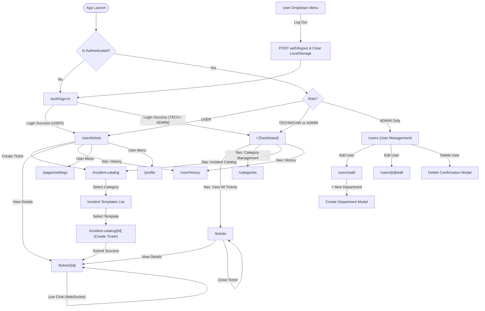

# 02. Screen & Navigation Map

## 1. Complete Route Inventory

The web application utilizes Next.js App Router with Route Groups `(Auth)` and `(Dashboard)`. Auth protection and role segregation are handled client-side by [src/components/AuthGuard.tsx](file:///D:/Course%20Wing/Final/fix/helpdesk-frontend/src/components/AuthGuard.tsx) and page-level role guards.

| Route Path | File Location | Access Level | Target Roles | Notes / Redirect Logic |
| :--- | :--- | :--- | :--- | :--- |
| `/auth/sign-in` | [src/app/(Auth)/auth/sign-in/page.tsx](file:///D:/Course%20Wing/Final/fix/helpdesk-frontend/src/app/(Auth)/auth/sign-in/page.tsx) | Public (Unauthenticated) | All Unauthenticated | If authenticated: `USER` redirected to `/user/tickets`; `ADMIN`/`TECHNICIAN` redirected to `/`. |
| `/` | [src/app/(Dashboard)/page.tsx](file:///D:/Course%20Wing/Final/fix/helpdesk-frontend/src/app/(Dashboard)/page.tsx) | Authenticated | `ADMIN`, `TECHNICIAN` | `AuthGuard` forcibly redirects `USER` role to `/user/tickets`. |
| `/calendar` | [src/app/(Dashboard)/calendar/page.tsx](file:///D:/Course%20Wing/Final/fix/helpdesk-frontend/src/app/(Dashboard)/calendar/page.tsx) | Authenticated | Any logged-in role | Leftover template page. Static calendar, not present in sidebar navigation. |
| `/categories` | [src/app/(Dashboard)/categories/page.tsx](file:///D:/Course%20Wing/Final/fix/helpdesk-frontend/src/app/(Dashboard)/categories/page.tsx) | Authenticated + Role Guard | `ADMIN`, `TECHNICIAN` | Page guard redirects non-agent roles to `/`. Full CRUD on categories and sub-issues. |
| `/incident-catalog` | [src/app/(Dashboard)/incident-catalog/page.tsx](file:///D:/Course%20Wing/Final/fix/helpdesk-frontend/src/app/(Dashboard)/incident-catalog/page.tsx) | Authenticated | `USER`, `TECHNICIAN`, `ADMIN` | Catalog view. Supports `?category=` URL query filter. |
| `/incident-catalog/[id]` | [src/app/(Dashboard)/incident-catalog/[id]/page.tsx](file:///D:/Course%20Wing/Final/fix/helpdesk-frontend/src/app/(Dashboard)/incident-catalog/[id]/page.tsx) | Authenticated | `USER`, `TECHNICIAN`, `ADMIN` | Dynamic route where `[id]` is the **SubCategory ID**. Contains ticket creation form. |
| `/pages/settings` | [src/app/(Dashboard)/pages/settings/page.tsx](file:///D:/Course%20Wing/Final/fix/helpdesk-frontend/src/app/(Dashboard)/pages/settings/page.tsx) | Authenticated | Any logged-in role | Linked from Header user menu. Contains disabled profile form and mock photo uploader. |
| `/profile` | [src/app/(Dashboard)/profile/page.tsx](file:///D:/Course%20Wing/Final/fix/helpdesk-frontend/src/app/(Dashboard)/profile/page.tsx) | Authenticated | Any logged-in role | Displays user profile stats, department, email, and joined date. |
| `/tickets` | [src/app/(Dashboard)/tickets/page.tsx](file:///D:/Course%20Wing/Final/fix/helpdesk-frontend/src/app/(Dashboard)/tickets/page.tsx) | Authenticated | `ADMIN`, `TECHNICIAN` | Master table of all tickets across the organization with status filtering and pagination. |
| `/tickets/[id]` | [src/app/(Dashboard)/tickets/[id]/page.tsx](file:///D:/Course%20Wing/Final/fix/helpdesk-frontend/src/app/(Dashboard)/tickets/[id]/page.tsx) | Authenticated | `USER`, `TECHNICIAN`, `ADMIN` | Detailed ticket view with status management, multi-image previews, and live chat. |
| `/tickets/[id]/edit` | [src/app/(Dashboard)/tickets/[id]/edit/page.tsx](file:///D:/Course%20Wing/Final/fix/helpdesk-frontend/src/app/(Dashboard)/tickets/[id]/edit/page.tsx) | Authenticated | `USER` | Incomplete route. Renders `TicketDetailView` which attempts to treat ticket id as subcategory id. |
| `/user/history` | [src/app/(Dashboard)/user/history/page.tsx](file:///D:/Course%20Wing/Final/fix/helpdesk-frontend/src/app/(Dashboard)/user/history/page.tsx) | Authenticated | `USER`, `TECHNICIAN`, `ADMIN` | Displays resolved/closed ticket history with completed timestamps. |
| `/user/tickets` | [src/app/(Dashboard)/user/tickets/page.tsx](file:///D:/Course%20Wing/Final/fix/helpdesk-frontend/src/app/(Dashboard)/user/tickets/page.tsx) | Authenticated | `USER` | Primary landing page for regular users. Lists their own reported tickets. |
| `/users` | [src/app/(Dashboard)/users/page.tsx](file:///D:/Course%20Wing/Final/fix/helpdesk-frontend/src/app/(Dashboard)/users/page.tsx) | Authenticated + Role Guard | `ADMIN` only | User management table with search, pagination, delete modal, and role badges. |
| `/users/add` | [src/app/(Dashboard)/users/add/page.tsx](file:///D:/Course%20Wing/Final/fix/helpdesk-frontend/src/app/(Dashboard)/users/add/page.tsx) | Authenticated + Role Guard | `ADMIN` only | User creation form with department creation modal launcher. |
| `/users/[id]/edit` | [src/app/(Dashboard)/users/[id]/edit/page.tsx](file:///D:/Course%20Wing/Final/fix/helpdesk-frontend/src/app/(Dashboard)/users/[id]/edit/page.tsx) | Authenticated + Role Guard | `ADMIN` only | User edit form with preloaded data by user ID. |

---

## 2. Detailed Screen Specifications

### 2.1 Sign In (`/auth/sign-in`)
- **File**: [src/app/(Auth)/auth/sign-in/page.tsx](file:///D:/Course%20Wing/Final/fix/helpdesk-frontend/src/app/(Auth)/auth/sign-in/page.tsx)
- **Access**: Public.
- **Main UI Sections**: Centered authentication card, logo badge, email input with Mail icon, password input with Lock icon, Submit button ("Sign In"), "Forgot password?" mock button, IT support help prompt.
- **Data / Endpoints**:
  - `POST auth/login` via `useLoginMutation` ([authApi.ts](file:///D:/Course%20Wing/Final/fix/helpdesk-frontend/src/redux/feature/auth/authApi.ts))
- **User Actions**:
  - Email & Password input changes.
  - Form Submit -> Client validation (presence check, regex email check `/\S+@\S+\.\S+/`).
  - Store dispatch: `setToken(accessToken)` and `setUser({ user, refreshToken })`.
  - Automatic redirect triggered by `AuthGuard`.
- **States**:
  - *Default*: Clean empty form.
  - *Loading*: Button disabled with spinning `Loader2` indicator and text "Signing in...".
  - *Error*: Red banner displaying either specific backend message or "Invalid credentials. Please try again." or "Network error: Cannot reach the backend server. Is it running?".

---

### 2.2 Dashboard Overview (`/`)
- **File**: [src/app/(Dashboard)/page.tsx](file:///D:/Course%20Wing/Final/fix/helpdesk-frontend/src/app/(Dashboard)/page.tsx)
- **Access**: `ADMIN` and `TECHNICIAN`. (`USER` redirected to `/user/tickets`).
- **Main UI Sections**:
  - Overview KPI Cards ([overview-cards/index.tsx](file:///D:/Course%20Wing/Final/fix/helpdesk-frontend/src/components/Dashboard/overview-cards/index.tsx)): "Total Tickets", "Pending Tickets", "Completed Tickets", and (if Admin) "Total Users".
  - Ticket Volume Analytics Chart ([payments-overview/index.tsx](file:///D:/Course%20Wing/Final/fix/helpdesk-frontend/src/components/Charts/payments-overview/index.tsx)): ApexCharts smooth spline area chart comparing monthly Completed vs Pending tickets.
  - Summary Metrics Footer: Counter display of completed vs pending counts.
- **Data / Endpoints**:
  - `GET tickets/stats` via `useGetDashboardStatsQuery`
  - `GET tickets/stats/monthly?year={currentYear}` via `useGetMonthlyStatsQuery`
- **User Actions**:
  - Hovering over chart data points to see tooltips.
- **States**:
  - *Loading*: Skeleton cards rendered by `OverviewCardsSkeleton` ([skeleton.tsx](file:///D:/Course%20Wing/Final/fix/helpdesk-frontend/src/components/Dashboard/overview-cards/skeleton.tsx)).
  - *Success*: Rendered KPI cards and animated ApexChart.

---

### 2.3 Category Management (`/categories`)
- **File**: [src/app/(Dashboard)/categories/page.tsx](file:///D:/Course%20Wing/Final/fix/helpdesk-frontend/src/app/(Dashboard)/categories/page.tsx) & [CategoryManager.tsx](file:///D:/Course%20Wing/Final/fix/helpdesk-frontend/src/components/Categories/CategoryManager.tsx)
- **Access**: `ADMIN` and `TECHNICIAN`.
- **Main UI Sections**:
  - PageHeader with title and "Create Main Category" action button.
  - Responsive Grid (1-col on mobile, 2-col on md, 3-col on lg).
  - Main Category Cards: Name, description, delete icon button, sub-issues list, "+ Add" sub-issue button.
  - Sub-issue list items: Name with individual delete button.
  - Create Category / Sub-Category Modal ([CreateCategoryModal.tsx](file:///D:/Course%20Wing/Final/fix/helpdesk-frontend/src/components/Categories/CreateCategoryModal.tsx)).
  - Delete Confirmation Modal ([Modal.tsx](file:///D:/Course%20Wing/Final/fix/helpdesk-frontend/src/components/ui/Modal.tsx)).
  - Toast notifications ([Toast.tsx](file:///D:/Course%20Wing/Final/fix/helpdesk-frontend/src/components/ui/Toast.tsx)).
- **Data / Endpoints**:
  - `GET categories` via `useGetCategoriesQuery`
  - `POST categories` via `useCreateCategoryMutation` (with or without `parentId`)
  - `DELETE categories/{id}` via `useDeleteCategoryMutation`
- **User Actions**:
  - Click "Create Main Category" -> opens modal with `parentId = null`.
  - Click "+ Add" on card -> opens modal with `parentId = main.id`.
  - Click trash icon on category or sub-category -> opens confirmation modal.
  - Confirm delete -> executes DELETE mutation, invalidates cache tag `Category`, shows Toast.
- **States**:
  - *Loading*: Centered spinner with "Loading categories...".
  - *Error*: Red alert box with "Failed to load categories." and "Retry" refetch button.
  - *Empty*: "No categories found. Create one to get started."

---

### 2.4 Incident Catalog (`/incident-catalog`)
- **File**: [src/app/(Dashboard)/incident-catalog/page.tsx](file:///D:/Course%20Wing/Final/fix/helpdesk-frontend/src/app/(Dashboard)/incident-catalog/page.tsx) & [IncidentCatalogView.tsx](file:///D:/Course%20Wing/Final/fix/helpdesk-frontend/src/components/Helpdesk/IncidentCatalogView.tsx)
- **Access**: All authenticated roles (`USER`, `TECHNICIAN`, `ADMIN`).
- **Main UI Sections**:
  - Dual-mode view:
    1. **Category Grid Mode** (when no category selected): Category card grid with custom Lucide icons mapped by category name, search input, and (if Admin/Tech) "Create Category" button.
    2. **Incident Template List Mode** (when category selected): Back button ("Back to Categories"), category title, list of sub-issue template cards with ticket icons.
- **Data / Endpoints**:
  - `GET categories` via `useGetCategoriesQuery`
- **User Actions**:
  - Search category filter input.
  - Click on a Category card -> sets active category (or updates URL query `?category=...`).
  - Click "Back to Categories" -> returns to grid.
  - Click on an Incident Template card -> navigates to `/incident-catalog/[id]` (where `[id]` is the subcategory ID).
- **States**:
  - *Loading*: Spinner with "Loading categories…".
  - *Empty Search*: "No categories match your search." or "No incident templates found for this category."

---

### 2.5 Submit Ticket / Incident Report (`/incident-catalog/[id]`)
- **File**: [src/app/(Dashboard)/incident-catalog/[id]/page.tsx](file:///D:/Course%20Wing/Final/fix/helpdesk-frontend/src/app/(Dashboard)/incident-catalog/[id]/page.tsx) & [TicketDetailView.tsx](file:///D:/Course%20Wing/Final/fix/helpdesk-frontend/src/components/Helpdesk/ticket/TicketDetailView.tsx)
- **Access**: All authenticated roles.
- **Main UI Sections**:
  - Ticket Header: Title ("Request [Category] for [SubCategory]"), requester name, created date, "Submit Ticket" action button.
  - Ticket Priority Selector: Dropdown for `LOW`, `MEDIUM`, `HIGH` (defaults to `MEDIUM`).
  - Description Textarea ([TicketDescription.tsx](file:///D:/Course%20Wing/Final/fix/helpdesk-frontend/src/components/Helpdesk/ticket/TicketDescription.tsx)).
  - Multi-File Attachment Box ([FileUploadBox.tsx](file:///D:/Course%20Wing/Final/fix/helpdesk-frontend/src/components/Helpdesk/ticket/FileUploadBox.tsx)): Drag-and-drop or file picker for images (`image/png, image/jpeg, image/jpg, image/webp`), thumbnail previews, remove file buttons.
- **Data / Endpoints**:
  - `GET categories` (to resolve category and subcategory names by `id`).
  - `POST images/upload` via `useUploadImageMutation` for each attached file.
  - `POST tickets` via `useCreateTicketMutation`.
- **User Actions**:
  - File picker / multi-file selection.
  - Delete individual attached image preview.
  - Select priority.
  - Enter description.
  - Click "Submit Ticket" -> Uploads images concurrently via `Promise.all` -> Submits ticket payload -> Shows success Toast -> Redirects after 1500ms to `/tickets/{newId}`.
- **States**:
  - *Submitting / Uploading*: Header button disabled with "Submitting..." state.
  - *Error*: Validation toast ("Please enter a description" or "Failed to upload images").

---

### 2.6 All Tickets (`/tickets`)
- **File**: [src/app/(Dashboard)/tickets/page.tsx](file:///D:/Course%20Wing/Final/fix/helpdesk-frontend/src/app/(Dashboard)/tickets/page.tsx) & [TicketTable.tsx](file:///D:/Course%20Wing/Final/fix/helpdesk-frontend/src/components/Tickets/TicketTable.tsx)
- **Access**: `ADMIN` and `TECHNICIAN`.
- **Main UI Sections**:
  - PageHeader: Search input, status filter dropdown (`ALL`, `PENDING`, `IN_PROGRESS`, `COMPLETED`), "Create Ticket" button (if Admin/User).
  - Data Table: Columns: Ticket ID (`#TCK-xxx`), Title, Requester, Department, Priority badge, Status badge, Assigned To, Created Date, Actions menu.
  - Row Action Menu ([ActionMenu.tsx](file:///D:/Course%20Wing/Final/fix/helpdesk-frontend/src/components/ui/ActionMenu.tsx)):
    - "View Details" -> Navigates to `/tickets/{id}`.
    - "Accept" (Technicians on PENDING tickets) -> Calls PATCH `tickets/{id}/status` with `IN_PROGRESS`.
    - "Close Ticket" (Technicians/Admins) -> Calls PATCH `tickets/{id}/status` with `COMPLETED`.
  - Pagination Control: 7 items per page with page numbers and ellipsis.
- **Data / Endpoints**:
  - `GET tickets` via `useGetTicketsQuery`
  - `PATCH tickets/{id}/status` via `useUpdateTicketStatusMutation`
- **User Actions**:
  - Client-side search by ticket ID, title, or department.
  - Client-side filter by status.
  - Change page in pagination.
  - Accept or close ticket from action menu.
- **States**:
  - *Loading*: "Loading tickets..." box.
  - *Empty*: "No tickets found." table row.

---

### 2.7 My Tickets (`/user/tickets`)
- **File**: [src/app/(Dashboard)/user/tickets/page.tsx](file:///D:/Course%20Wing/Final/fix/helpdesk-frontend/src/app/(Dashboard)/user/tickets/page.tsx)
- **Access**: `USER` (also landing page after sign-in).
- **Main UI Sections**:
  - Table of user's own tickets. Same layout as `/tickets`, but `Assigned To` column is hidden (`hideAssignedTo={true}`).
  - Action menu includes "Edit" option for PENDING tickets (which navigates to `/incident-catalog`).
  - Search and status filter dropdowns.
  - Pagination (7 items per page).
- **Data / Endpoints**:
  - `GET tickets/my` via `useGetMyTicketsQuery`
- **User Actions**:
  - View ticket details (`/tickets/{id}`).
  - Click "Create Ticket" -> `/incident-catalog`.

---

### 2.8 Ticket History (`/user/history`)
- **File**: [src/app/(Dashboard)/user/history/page.tsx](file:///D:/Course%20Wing/Final/fix/helpdesk-frontend/src/app/(Dashboard)/user/history/page.tsx)
- **Access**: All roles (`USER`, `TECHNICIAN`, `ADMIN`).
- **Main UI Sections**:
  - Table of completed/closed tickets.
  - Additional column: `Completed Date` (`showCompletedDate={true}`).
  - Search, status filter, and pagination (7 items per page).
- **Data / Endpoints**:
  - `GET tickets/history` via `useGetTicketHistoryQuery`

---

### 2.9 Ticket Detail & Live Chat (`/tickets/[id]`)
- **File**: [src/app/(Dashboard)/tickets/[id]/page.tsx](file:///D:/Course%20Wing/Final/fix/helpdesk-frontend/src/app/(Dashboard)/tickets/[id]/page.tsx) & [TicketDetail.tsx](file:///D:/Course%20Wing/Final/fix/helpdesk-frontend/src/components/Tickets/TicketDetail.tsx)
- **Access**: All authenticated roles.
- **Main UI Sections**:
  - "Back to tickets" navigation button (`router.back()`).
  - Header: Ticket formatted ID (`#TCK-xxx`), status badge, priority badge, ticket title.
  - Status Transition Action Buttons (Technician only):
    - "Accept" button (visible if `PENDING`) -> sets status to `IN_PROGRESS`.
    - "Close Ticket" button (visible if `IN_PROGRESS`) -> sets status to `COMPLETED`.
  - Details Grid: Requester name/email, Assigned To, Department, Created timestamp.
  - Description Section: Formatted text description.
  - Attachments Gallery: Supports legacy single `imageUrl` or array `imageUrls`. Clicking image opens full-size image in new tab.
  - Live Ticket Conversation ([TicketChat.tsx](file:///D:/Course%20Wing/Final/fix/helpdesk-frontend/src/components/Tickets/TicketChat.tsx)):
    - Historical chat messages loaded via REST.
    - Live incoming messages via WebSocket subscription.
    - Chat message input with Enter key or Send button trigger.
    - Auto-scroll to latest message.
- **Data / Endpoints**:
  - `GET tickets/{id}` via `useGetTicketByIdQuery`
  - `PATCH tickets/{id}/status` via `useUpdateTicketStatusMutation`
  - `GET tickets/{id}/messages` via `useGetTicketMessagesQuery`
  - WebSocket: Connect to `/ws-chat`, subscribe to `/topic/ticket/{ticketId}`, publish to `/app/chat`.
- **States**:
  - *Loading*: "Loading ticket details...".
  - *Not Found*: "Ticket not found".

---

### 2.10 User Management (`/users`)
- **File**: [src/app/(Dashboard)/users/page.tsx](file:///D:/Course%20Wing/Final/fix/helpdesk-frontend/src/app/(Dashboard)/users/page.tsx) & [UserTable.tsx](file:///D:/Course%20Wing/Final/fix/helpdesk-frontend/src/components/Users/UserTable.tsx)
- **Access**: `ADMIN` only.
- **Main UI Sections**:
  - PageHeader: Search input, "+ Add User" button (links to `/users/add`).
  - Table: User (avatar with fallback initials, full name, email), Access (Role badge with custom color styling), Last Active (relative time with tooltip showing absolute timestamp), Created Date, Action Menu.
  - Action Menu: "Edit" (`/users/{id}/edit`) and "Delete" (opens modal).
  - Delete User Confirmation Modal: Warnings and delete action.
  - Pagination (10 items per page).
- **Data / Endpoints**:
  - `GET users` via `useGetUsersQuery`
  - `DELETE users/{id}` via `useDeleteUserMutation`
- **States**:
  - *Loading*: "Loading users...".
  - *Empty*: "No users found."

---

### 2.11 Add User (`/users/add`)
- **File**: [src/app/(Dashboard)/users/add/page.tsx](file:///D:/Course%20Wing/Final/fix/helpdesk-frontend/src/app/(Dashboard)/users/add/page.tsx) & [AddUserForm.tsx](file:///D:/Course%20Wing/Final/fix/helpdesk-frontend/src/components/Users/AddUserForm.tsx)
- **Access**: `ADMIN` only.
- **Main UI Sections**:
  - Header with close "X" link back to `/users`.
  - Form Fields: First Name, Last Name, Email, Phone Number, Password (with toggle password visibility Eye/EyeOff), Role dropdown (`ADMIN`, `TECHNICIAN`, `USER`), Department dropdown with "+ New Department" launcher button.
  - Create Department Modal ([CreateDepartmentModal.tsx](file:///D:/Course%20Wing/Final/fix/helpdesk-frontend/src/components/Users/CreateDepartmentModal.tsx)).
  - Buttons: Cancel and "Create User".
- **Data / Endpoints**:
  - `GET departments` via `useGetDepartmentsQuery`
  - `POST departments` via `useCreateDepartmentMutation`
  - `POST users` via `useCreateUserMutation`
- **User Actions**:
  - Create new department inline without losing form data.
  - Submit new user -> redirects to `/users`.

---

### 2.12 Edit User (`/users/[id]/edit`)
- **File**: [src/app/(Dashboard)/users/[id]/edit/page.tsx](file:///D:/Course%20Wing/Final/fix/helpdesk-frontend/src/app/(Dashboard)/users/[id]/edit/page.tsx) & [EditUserForm.tsx](file:///D:/Course%20Wing/Final/fix/helpdesk-frontend/src/components/Users/EditUserForm.tsx)
- **Access**: `ADMIN` only.
- **Main UI Sections**:
  - Same fields as Add User, preloaded with existing user data.
  - Password field labeled "(leave empty to keep current)".
- **Data / Endpoints**:
  - `GET users/{id}` via `useGetUserByIdQuery`
  - `GET departments` via `useGetDepartmentsQuery`
  - `PUT users/{id}` via `useUpdateUserMutation`

---

### 2.13 User Profile (`/profile`)
- **File**: [src/app/(Dashboard)/profile/page.tsx](file:///D:/Course%20Wing/Final/fix/helpdesk-frontend/src/app/(Dashboard)/profile/page.tsx) & [ProfileView.tsx](file:///D:/Course%20Wing/Final/fix/helpdesk-frontend/src/components/Profile/ProfileView.tsx)
- **Access**: All authenticated roles.
- **Main UI Sections**:
  - Cover photo and profile avatar with local file selection preview.
  - User details: Full Name, Role, Email, Department Name, Member Since date.
  - Summary Ticket Metrics Grid: Tickets Created, Tickets Assigned, Tickets Resolved, Tickets Open.
- **Data / Endpoints**:
  - `GET users/{id}` via `useGetUserByIdQuery(currentUser.id)`

---

### 2.14 Settings (`/pages/settings`)
- **File**: [src/app/(Dashboard)/pages/settings/page.tsx](file:///D:/Course%20Wing/Final/fix/helpdesk-frontend/src/app/(Dashboard)/pages/settings/page.tsx)
- **Access**: All authenticated roles.
- **Main UI Sections**:
  - Personal Information Form ([personal-info.tsx](file:///D:/Course%20Wing/Final/fix/helpdesk-frontend/src/components/Settings/personal-info.tsx)): Read-only display of First Name, Last Name, and Email (all inputs are marked `disabled`).
  - Upload Photo Form ([upload-photo.tsx](file:///D:/Course%20Wing/Final/fix/helpdesk-frontend/src/components/Settings/upload-photo.tsx)): Visual mock file uploader (no API wiring).
- **Data / Endpoints**:
  - Reads current user from Redux store (`selectCurrentUser`). No API mutation.

---

## 3. Navigation Flow Diagram

---

## 4. Shared Layouts & Mobile Adaptation Architecture

### 4.1 Desktop Web Layout Breakdown
- **Sidebar ([src/components/Layouts/sidebar/index.tsx](file:///D:/Course%20Wing/Final/fix/helpdesk-frontend/src/components/Layouts/sidebar/index.tsx))**:
  - Sticky left sidebar (width 290px). Collapsible on mobile into an overlay drawer.
  - Displays logo, main navigation section filtered by user role, and (for regular users) a dynamic category list fetched from `GET categories`.
- **Header ([src/components/Layouts/header/index.tsx](file:///D:/Course%20Wing/Final/fix/helpdesk-frontend/src/components/Layouts/header/index.tsx))**:
  - Sticky top app bar. Contains mobile drawer hamburger toggle, user role navigation links (`My Tickets`, `History`), and User Profile Dropdown menu (Account Settings, Log Out).
- **Page Container**:
  - Responsive content container (`max-w-screen-2xl mx-auto p-4 md:p-6 2xl:p-10`).

### 4.2 Flutter Mobile Adaptation Strategy

| Web Element | Mobile Alternative in Flutter | Implementation Details |
| :--- | :--- | :--- |
| **Sidebar Navigation** | **BottomNavigationBar** + **Modal Navigation Drawer** | For primary screens (Dashboard/Tickets, History, Catalog, Profile), use a 4-tab `NavigationBar` (Material 3). Secondary features (Categories, User Management) live in a Drawer or Admin Hub screen. |
| **Header User Menu** | **SliverAppBar** / Profile Tab | User avatar in top-right app bar navigates directly to `ProfileScreen` or opens a bottom action sheet with Settings & Logout. |
| **Data Tables** (`TicketTable`, `UserTable`) | **Card List / Slidable Tiles** | Replace wide multi-column tables with vertical `ListView.builder` cards displaying ticket title, priority pill, status badge, relative time, and swipe actions (`flutter_slidable` for Accept/Close). |
| **Modal Dialogs** (`Radix Dialog`) | **Modal Bottom Sheets** (`showModalBottomSheet`) | Creation forms (Create Category, Create Department, Delete Confirmations) adapt cleanly into scrollable rounded bottom sheets. |
| **Hover Tooltips** (`Radix Tooltip`) | **Inline Secondary Text** / Tap to toggle | Replace mouse-hover tooltips on dates with explicit secondary subtitles (e.g. "2h ago • Oct 22, 2026, 12:30 PM"). |
| **Desktop Dropdowns** | **Bottom Sheets or Cupertino Action Sheets** | Dropdown filters (e.g., status filter) open a quick single-select bottom sheet with radio buttons. |
