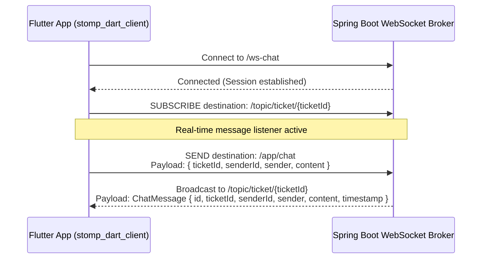

# 04. API Contract & Data Specification

## 1. Overview & Protocol Architecture

The frontend communicates with the Spring Boot backend using:
1. **REST APIs**: JSON over HTTP, prefixed with `/api/v1/` (proxied in web via Next.js at `/api/v1/[...path]`).
2. **Multipart Uploads**: `multipart/form-data` for file and image uploads.
3. **WebSocket (STOMP over SockJS)**: Full-duplex messaging protocol mounted at `/ws-chat`.

### Global Request Headers
Except for unauthenticated endpoints (`auth/login` and `auth/refresh`), all REST calls require:
```http
Authorization: Bearer <accessToken>
X-Requested-With: XMLHttpRequest
Content-Type: application/json
```

### Standard Error Response Format
When an API error occurs, Spring Boot returns a JSON object formatted as:
```json
{
  "timestamp": "2026-10-22T05:30:00.000+00:00",
  "status": 400,
  "error": "Bad Request",
  "message": "Specific error description message",
  "path": "/api/v1/..."
}
```
In RTK Query, this is parsed into `error.data.message` and displayed via `<Toast>` or inline form alert.

---

## 2. Comprehensive REST Endpoint Specifications

### 2.1 Authentication Module (`authApi.ts`)

#### 1. `POST auth/login`
- **File**: [src/redux/feature/auth/authApi.ts](file:///D:/Course%20Wing/Final/fix/helpdesk-frontend/src/redux/feature/auth/authApi.ts#L22-L53)
- **Auth Required**: No.
- **Request Body**:
  ```json
  {
    "email": "user@example.com",
    "password": "Password123"
  }
  ```
- **Response Shape (200 OK)**:
  *Supports either nested user object or flat structure:*
  ```json
  {
    "accessToken": "eyJhbGciOi...",
    "refreshToken": "d8e3b2c1-...",
    "user": {
      "id": 1,
      "email": "user@example.com",
      "firstName": "Sophea",
      "lastName": "Chan",
      "departmentId": 2,
      "role": "USER",
      "imageUrl": "https://..."
    }
  }
  ```
  *(Or flat structure where `id`, `email`, `role`, etc., are top-level properties).*

#### 2. `POST auth/refresh`
- **File**: [src/redux/feature/auth/authApi.ts](file:///D:/Course%20Wing/Final/fix/helpdesk-frontend/src/redux/feature/auth/authApi.ts#L54-L60)
- **Auth Required**: No (uses refresh token in body).
- **Request Body**:
  ```json
  {
    "refreshToken": "d8e3b2c1-..."
  }
  ```
- **Response Shape (200 OK)**:
  ```json
  {
    "accessToken": "eyJhbGciOi..."
  }
  ```
- **Status Codes**: `200 OK`, `401 Unauthorized` (triggers logout).

#### 3. `POST auth/logout`
- **File**: [src/redux/feature/auth/authApi.ts](file:///D:/Course%20Wing/Final/fix/helpdesk-frontend/src/redux/feature/auth/authApi.ts#L61-L66)
- **Auth Required**: Yes (Bearer Token).
- **Request Body**: Empty.
- **Response Shape (200 OK)**: Empty.

---

### 2.2 Category Module (`categoryApi.ts`)

#### 4. `GET categories`
- **File**: [src/redux/feature/category/categoryApi.ts](file:///D:/Course%20Wing/Final/fix/helpdesk-frontend/src/redux/feature/category/categoryApi.ts#L19-L22)
- **Auth Required**: Yes.
- **Cache Tags**: Provides `["Category"]`.
- **Response Shape (200 OK)**:
  ```json
  [
    {
      "id": 101,
      "name": "IT Incident Management",
      "description": "General IT hardware and software incidents",
      "parentId": null,
      "subCategories": [
        {
          "id": 201,
          "name": "Laptop Won't Power On",
          "description": "Hardware failure regarding battery or motherboard",
          "parentId": 101
        }
      ]
    }
  ]
  ```

#### 5. `POST categories`
- **File**: [src/redux/feature/category/categoryApi.ts](file:///D:/Course%20Wing/Final/fix/helpdesk-frontend/src/redux/feature/category/categoryApi.ts#L23-L30)
- **Auth Required**: Yes.
- **Cache Invalidation**: Invalidates `["Category"]`.
- **Request Body**:
  ```json
  {
    "name": "Finance System Issue",
    "description": "Issues related to QuickBooks and ERP",
    "parentId": null
  }
  ```
  *(To create a sub-issue, supply parent ID: `"parentId": 101`).*
- **Response Shape (201 Created / 200 OK)**: Returns created `Category` object.

#### 6. `PUT categories/{id}`
- **File**: [src/redux/feature/category/categoryApi.ts](file:///D:/Course%20Wing/Final/fix/helpdesk-frontend/src/redux/feature/category/categoryApi.ts#L31-L38)
- **Auth Required**: Yes.
- **Request Body**:
  ```json
  {
    "name": "Updated Category Name",
    "description": "Updated Description",
    "parentId": null
  }
  ```
- **Response Shape (200 OK)**: Updated `Category` object.

#### 7. `DELETE categories/{id}`
- **File**: [src/redux/feature/category/categoryApi.ts](file:///D:/Course%20Wing/Final/fix/helpdesk-frontend/src/redux/feature/category/categoryApi.ts#L39-L45)
- **Auth Required**: Yes.
- **Response Status**: `204 No Content` (Empty body).

---

### 2.3 Department Module (`departmentApi.ts`)

#### 8. `GET departments`
- **File**: [src/redux/feature/department/departmentApi.ts](file:///D:/Course%20Wing/Final/fix/helpdesk-frontend/src/redux/feature/department/departmentApi.ts#L14-L17)
- **Auth Required**: Yes.
- **Cache Tags**: Provides `["Department"]`.
- **Response Shape (200 OK)**:
  ```json
  [
    {
      "id": 1,
      "name": "Human Resources"
    },
    {
      "id": 2,
      "name": "Software Engineering"
    }
  ]
  ```

#### 9. `POST departments`
- **File**: [src/redux/feature/department/departmentApi.ts](file:///D:/Course%20Wing/Final/fix/helpdesk-frontend/src/redux/feature/department/departmentApi.ts#L18-L25)
- **Auth Required**: Yes.
- **Cache Invalidation**: Invalidates `["Department"]`.
- **Request Body**:
  ```json
  {
    "name": "Quality Assurance"
  }
  ```
- **Response Shape (201 Created / 200 OK)**: Returns created `Department` object (`{ "id": 3, "name": "Quality Assurance" }`).

---

### 2.4 Ticket Module (`ticketApi.ts`)

#### 10. `GET tickets`
- **File**: [src/redux/feature/ticket/ticketApi.ts](file:///D:/Course%20Wing/Final/fix/helpdesk-frontend/src/redux/feature/ticket/ticketApi.ts#L56-L60)
- **Auth Required**: Yes (`ADMIN`, `TECHNICIAN`).
- **Cache Tags**: Provides `["Ticket"]`.
- **Backend Response**: Spring Page object `{ "content": TicketResponse[], "totalPages": ..., "totalElements": ... }`.
- **Transformed Frontend Response**: Extracts and returns `response.content`.
- **Response Item Shape**:
  ```json
  {
    "id": 12,
    "ticketTitle": "Cannot Connect to Office VPN",
    "description": "Getting timeout error 404 when connecting to Phnom Penh gateway.",
    "priority": "HIGH",
    "status": "PENDING",
    "categoryId": 102,
    "categoryName": "IT Network Issue",
    "subCategoryId": 204,
    "subCategoryName": "VPN Connectivity",
    "assignedTo": null,
    "assignedName": null,
    "createdBy": 5,
    "createdByName": "John Doe",
    "createdAt": "2026-10-22T04:15:00.000Z",
    "completedAt": null,
    "imageUrl": "https://pub-...r2.dev/tickets/error1.png",
    "imageUrls": [
      "https://pub-...r2.dev/tickets/error1.png",
      "https://pub-...r2.dev/tickets/error2.png"
    ]
  }
  ```

#### 11. `GET tickets/my`
- **File**: [src/redux/feature/ticket/ticketApi.ts](file:///D:/Course%20Wing/Final/fix/helpdesk-frontend/src/redux/feature/ticket/ticketApi.ts#L74-L82)
- **Auth Required**: Yes (`USER`).
- **Response Shape**: Same as `tickets`, filtered to current user.

#### 12. `GET tickets/history`
- **File**: [src/redux/feature/ticket/ticketApi.ts](file:///D:/Course%20Wing/Final/fix/helpdesk-frontend/src/redux/feature/ticket/ticketApi.ts#L61-L65)
- **Auth Required**: Yes.
- **Response Shape**: List of tickets where status is `COMPLETED`, containing `completedAt` timestamp.

#### 13. `GET tickets/{id}`
- **File**: [src/redux/feature/ticket/ticketApi.ts](file:///D:/Course%20Wing/Final/fix/helpdesk-frontend/src/redux/feature/ticket/ticketApi.ts#L66-L69)
- **Auth Required**: Yes.
- **Cache Tags**: Provides `[{ type: "Ticket", id }]`.
- **Response Shape**: Single `TicketResponse` object.

#### 14. `POST tickets`
- **File**: [src/redux/feature/ticket/ticketApi.ts](file:///D:/Course%20Wing/Final/fix/helpdesk-frontend/src/redux/feature/ticket/ticketApi.ts#L99-L106)
- **Auth Required**: Yes.
- **Cache Invalidation**: Invalidates `["Ticket"]`.
- **Request Body**:
  ```json
  {
    "ticketTitle": "Broken Display on Monitor",
    "description": "Flickering lines appeared horizontally this morning.",
    "categoryId": 101,
    "subCategoryId": 203,
    "priority": "MEDIUM",
    "status": "PENDING",
    "imageUrls": [
      "https://pub-...r2.dev/screenshot.png"
    ]
  }
  ```
- **Response Shape (201 Created)**: Returns created `TicketResponse` object with generated `id`.

#### 15. `PATCH tickets/{id}/status`
- **File**: [src/redux/feature/ticket/ticketApi.ts](file:///D:/Course%20Wing/Final/fix/helpdesk-frontend/src/redux/feature/ticket/ticketApi.ts#L107-L114)
- **Auth Required**: Yes (`TECHNICIAN`, `ADMIN`).
- **Cache Invalidation**: Invalidates `["Ticket"]`.
- **Request Body**:
  ```json
  {
    "status": "IN_PROGRESS",
    "remark": "Accepted by technician"
  }
  ```
  *(Or `"status": "COMPLETED"` with remark `"Closed by technician"`).*
- **Response Shape (200 OK)**: Returns updated `TicketResponse`.

#### 16. `POST images/upload`
- **File**: [src/redux/feature/ticket/ticketApi.ts](file:///D:/Course%20Wing/Final/fix/helpdesk-frontend/src/redux/feature/ticket/ticketApi.ts#L115-L121)
- **Auth Required**: Yes.
- **Content-Type**: `multipart/form-data`.
- **Form Fields**: `file` (Binary image file: PNG, JPG, JPEG, WEBP up to 5MB).
- **Response Shape (200 OK)**:
  ```json
  {
    "url": "https://pub-...r2.dev/uploads/uuid-image.png"
  }
  ```

#### 17. `GET tickets/{id}/messages`
- **File**: [src/redux/feature/ticket/ticketApi.ts](file:///D:/Course%20Wing/Final/fix/helpdesk-frontend/src/redux/feature/ticket/ticketApi.ts#L70-L73)
- **Auth Required**: Yes.
- **Response Shape (200 OK)**:
  ```json
  [
    {
      "id": 1,
      "ticketId": 12,
      "senderId": 5,
      "sender": "John Doe",
      "content": "Can you try pinging 192.168.1.1?",
      "timestamp": "2026-10-22T04:20:00.000Z"
    }
  ]
  ```

#### 18. `GET tickets/stats`
- **File**: [src/redux/feature/ticket/ticketApi.ts](file:///D:/Course%20Wing/Final/fix/helpdesk-frontend/src/redux/feature/ticket/ticketApi.ts#L83-L86)
- **Auth Required**: Yes (`ADMIN`, `TECHNICIAN`).
- **Response Shape (200 OK)**:
  ```json
  {
    "totalTickets": 142,
    "pendingTickets": 23,
    "inProgressTickets": 18,
    "completedTickets": 101,
    "totalUsers": 58
  }
  ```

#### 19. `GET tickets/stats/monthly?year={year}`
- **File**: [src/redux/feature/ticket/ticketApi.ts](file:///D:/Course%20Wing/Final/fix/helpdesk-frontend/src/redux/feature/ticket/ticketApi.ts#L87-L90)
- **Auth Required**: Yes.
- **Query Params**: `year` (e.g. `2026`).
- **Response Shape (200 OK)**:
  ```json
  {
    "received": [12, 18, 25, 20, 15, 30, 28, 22, 19, 24, 18, 12],
    "due": [5, 4, 8, 3, 2, 7, 6, 4, 2, 5, 3, 1]
  }
  ```

#### 20. `GET tickets/activity`
- **File**: [src/redux/feature/ticket/ticketApi.ts](file:///D:/Course%20Wing/Final/fix/helpdesk-frontend/src/redux/feature/ticket/ticketApi.ts#L91-L98)
- **Auth Required**: Yes.
- **Response Shape (200 OK)**:
  ```json
  [
    {
      "id": 501,
      "image": "https://pub-...r2.dev/avatars/user.png",
      "title": "Ticket #12 Accepted",
      "subTitle": "Technician Alex accepted your incident report",
      "createdAt": "2026-10-22T04:18:00.000Z"
    }
  ]
  ```

---

### 2.5 User Management Module (`userApi.ts`)

#### 21. `GET users`
- **File**: [src/redux/feature/user/userApi.ts](file:///D:/Course%20Wing/Final/fix/helpdesk-frontend/src/redux/feature/user/userApi.ts#L33-L36)
- **Auth Required**: Yes (`ADMIN`).
- **Cache Tags**: Provides `["User"]`.
- **Response Shape (200 OK)**:
  ```json
  [
    {
      "id": 1,
      "firstName": "Alex",
      "lastName": "Vannak",
      "email": "alex.vannak@helpdesk.com",
      "phoneNumber": "+85512345678",
      "imageUrl": null,
      "role": "ADMIN",
      "departmentId": 2,
      "departmentName": "IT Infrastructure",
      "createdAt": "2026-01-15T08:00:00.000Z",
      "updatedAt": "2026-10-22T04:00:00.000Z",
      "ticketsCreated": 5,
      "ticketsAssigned": 42,
      "ticketsResolved": 38,
      "ticketsOpen": 4
    }
  ]
  ```

#### 22. `POST users`
- **File**: [src/redux/feature/user/userApi.ts](file:///D:/Course%20Wing/Final/fix/helpdesk-frontend/src/redux/feature/user/userApi.ts#L37-L44)
- **Auth Required**: Yes (`ADMIN`).
- **Cache Invalidation**: Invalidates `["User"]`.
- **Request Body**:
  ```json
  {
    "firstName": "Rithy",
    "lastName": "Sok",
    "email": "rithy.sok@helpdesk.com",
    "phoneNumber": "+85598765432",
    "password": "InitialPassword123!",
    "role": "TECHNICIAN",
    "departmentId": "2"
  }
  ```
- **Response Shape (201 Created)**: Returns created `UserResponse`.

#### 23. `GET users/{id}`
- **File**: [src/redux/feature/user/userApi.ts](file:///D:/Course%20Wing/Final/fix/helpdesk-frontend/src/redux/feature/user/userApi.ts#L52-L55)
- **Auth Required**: Yes.
- **Cache Tags**: Provides `[{ type: "User", id }]`.
- **Response Shape (200 OK)**: Returns detailed `UserResponse` including metric counts (`ticketsCreated`, `ticketsAssigned`, `ticketsResolved`, `ticketsOpen`).

#### 24. `PUT users/{id}`
- **File**: [src/redux/feature/user/userApi.ts](file:///D:/Course%20Wing/Final/fix/helpdesk-frontend/src/redux/feature/user/userApi.ts#L56-L63)
- **Auth Required**: Yes (`ADMIN`).
- **Cache Invalidation**: Invalidates `["User"]`.
- **Request Body**: Partial update object with fields to update:
  ```json
  {
    "firstName": "Rithy",
    "lastName": "Sok",
    "email": "rithy.sok@helpdesk.com",
    "phoneNumber": "+85598765432",
    "password": "",
    "role": "TECHNICIAN",
    "departmentId": "2",
    "imageUrl": null
  }
  ```
- **Response Shape (200 OK)**: Returns updated `UserResponse`.

#### 25. `DELETE users/{id}`
- **File**: [src/redux/feature/user/userApi.ts](file:///D:/Course%20Wing/Final/fix/helpdesk-frontend/src/redux/feature/user/userApi.ts#L45-L51)
- **Auth Required**: Yes (`ADMIN`).
- **Cache Invalidation**: Invalidates `["User"]`.
- **Response Status**: `204 No Content` (Empty body).

---

## 3. Real-Time WebSocket Contract (STOMP over SockJS)

- **Handshake Endpoint**: `${backendUrl}/ws-chat`
- **Protocol**: STOMP 1.2 over SockJS
- **Authentication**: Connect frame or SockJS query param (in web, connects without explicit STOMP auth headers, relying on prior cookie/session or open WS handshake).



### STOMP Message Payloads

#### Send Message (`destination: /app/chat`):
```json
{
  "ticketId": 12,
  "senderId": 5,
  "sender": "John Doe",
  "content": "Please review the updated screenshot."
}
```

#### Received Message (`topic: /topic/ticket/{ticketId}`):
```json
{
  "id": 104,
  "ticketId": 12,
  "senderId": 5,
  "sender": "John Doe",
  "content": "Please review the updated screenshot.",
  "timestamp": "2026-10-22T04:22:15.000Z"
}
```

---

## 4. Architectural Inconsistencies & Backend Gaps

1. **Client-Side Slicing vs Server Pagination**:
   `GET tickets`, `GET tickets/my`, `GET tickets/history`, and `GET users` return all records in a single array or `content` list. The web frontend paginates in-memory (`tickets.slice(0, 7)`). For mobile performance and low bandwidth, the backend should accept standard pagination params (`?page=0&size=20&sort=createdAt,desc`).
2. **Client-Side In-Memory Filtering**:
   Status filters (`PENDING`, `IN_PROGRESS`, `COMPLETED`) and search strings are applied using JavaScript `.filter()`. A production mobile app should query `GET tickets?status=PENDING&search=VPN`.
3. **Incomplete `/tickets/[id]/edit` Route**:
   Web route `src/app/(Dashboard)/tickets/[id]/edit/page.tsx` renders `TicketDetailView` which treats `id` as a SubCategory ID and calls `POST tickets` instead of updating an existing ticket. No `PUT tickets/{id}` endpoint exists in RTK Query.
4. **Settings Photo Upload Unwired**:
   In [upload-photo.tsx](file:///D:/Course%20Wing/Final/fix/helpdesk-frontend/src/components/Settings/upload-photo.tsx), the avatar uploader does not make an API call to save the new image URL to `PUT users/{id}`.
5. **WebSocket Authentication**:
   The web app uses SockJS without sending the `Authorization: Bearer <token>` in STOMP connect headers. Mobile needs to ensure whether Spring Boot requires auth headers or allows anonymous STOMP connection.
