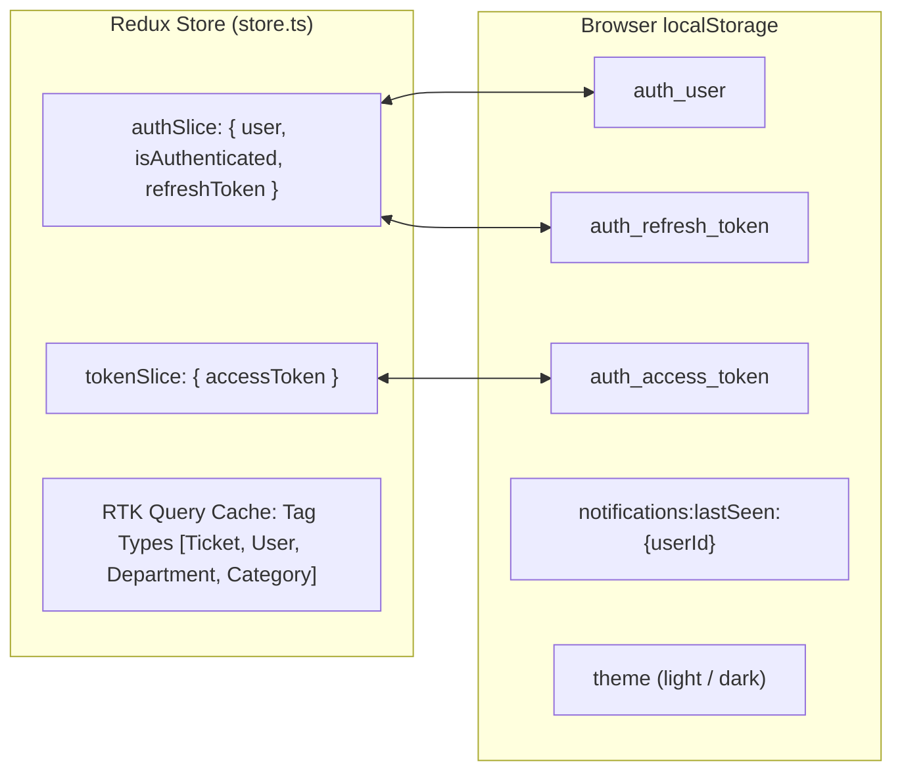

# 05. Data, State, and Form Specifications

## 1. Global State & Persistence Model

The web application utilizes **Redux Toolkit** configured in [src/redux/store.ts](file:///D:/Course%20Wing/Final/fix/helpdesk-frontend/src/redux/store.ts) alongside RTK Query for server state.



### 1.1 Slices & In-Memory Stores

| Slice Name | File Location | Properties | Persistence Mechanism |
| :--- | :--- | :--- | :--- |
| **`auth`** | [src/redux/feature/auth/authSlice.ts](file:///D:/Course%20Wing/Final/fix/helpdesk-frontend/src/redux/feature/auth/authSlice.ts) | - `user: User \| null`<br/>- `isAuthenticated: boolean`<br/>- `refreshToken: string \| null` | Persisted via `store.subscribe()` to `localStorage.setItem("auth_user", ...)` and `localStorage.setItem("auth_refresh_token", ...)`. Rehydrated on launch via `loadAuthFromStorage()`. |
| **`token`** | [src/redux/feature/auth/tokenSlice.ts](file:///D:/Course%20Wing/Final/fix/helpdesk-frontend/src/redux/feature/auth/tokenSlice.ts) | - `accessToken: string \| null` | Persisted to `localStorage.setItem("auth_access_token", ...)`. Rehydrated via `loadAccessTokenFromStorage()`. |
| **`api`** | [src/redux/api.ts](file:///D:/Course%20Wing/Final/fix/helpdesk-frontend/src/redux/api.ts) | Normalized RTK Query server cache. | In-memory only; refetched on page mount / invalidation. |
| **`role`** | [src/app/role-context.tsx](file:///D:/Course%20Wing/Final/fix/helpdesk-frontend/src/app/role-context.tsx) | Derived role string: `state.auth.user?.role?.toLowerCase() \|\| "user"`. | Derived from `auth.user`. |
| **`notification`** | [notification/index.tsx](file:///D:/Course%20Wing/Final/fix/helpdesk-frontend/src/components/Layouts/header/notification/index.tsx) | `lastSeen` ISO timestamp. | Persisted in `localStorage.setItem("notifications:lastSeen:{userId}", ...)`. |

### 1.2 Mobile Migration Recommendation for State
In Flutter, split these concerns using **Riverpod**:
1. `authNotifierProvider`: StateNotifier holding `AuthState(user, isAuthenticated)` with secure reading/writing to `flutter_secure_storage`.
2. `tokenRepository`: Secure token holder with automated access token retrieval for Dio interceptors.
3. Feature Providers: Family providers (e.g. `ticketListProvider(statusFilter)`) replacing RTK Query endpoints.

---

## 2. Exhaustive Form Inventory

The web application does not use external schema validation libraries (such as Zod or Yup). Forms rely on standard React controlled/uncontrolled state with inline validation.

---

### Form 1: Sign In Form
- **Screen**: `/auth/sign-in` ([src/app/(Auth)/auth/sign-in/page.tsx](file:///D:/Course%20Wing/Final/fix/helpdesk-frontend/src/app/(Auth)/auth/sign-in/page.tsx))
- **Trigger**: "Sign In" button click or Enter key.

| Field Name | Type | UI Component | Validations & Rules | Default Value | Error Feedback |
| :--- | :--- | :--- | :--- | :--- | :--- |
| `email` | `string` | `<input type="email">` | Required; regex: `/\S+@\S+\.\S+/`. | `""` | "Please enter both email and password." / "Please enter a valid email address." |
| `password` | `string` | `<input type="password">` | Required; non-empty. | `""` | "Please enter both email and password." |

- **Submit Behavior**:
  Calls `useLoginMutation({ email, password })`. On success, dispatches `setToken` and `setUser`, which triggers `AuthGuard` redirect. On error, renders inline red alert banner.

---

### Form 2: Category & Sub-Issue Creation Modal
- **Screens**: `/categories` ([CreateCategoryModal.tsx](file:///D:/Course%20Wing/Final/fix/helpdesk-frontend/src/components/Categories/CreateCategoryModal.tsx)) & `/incident-catalog` ([CreateCategoryModal.tsx](file:///D:/Course%20Wing/Final/fix/helpdesk-frontend/src/components/Helpdesk/CreateCategoryModal.tsx))
- **Trigger**: "Create Category" button.

| Field Name | Type | UI Component | Validations & Rules | Default Value | Error Feedback |
| :--- | :--- | :--- | :--- | :--- | :--- |
| `name` | `string` | `<Input>` | Required; trimmed non-empty string. | `""` | "Category name is required." |
| `description` | `string?` | `<textarea rows={3}>` | Optional; trimmed string. | `""` | None. |
| `parentId` | `number?` | Hidden / Props | `null` for Main Category; parent ID for Sub-Issue. | Prop value | Backend validation error string. |

- **Submit Behavior**:
  Calls `useCreateCategoryMutation({ name, description, parentId })`. On success, closes modal and resets inputs. Invalidates `Category` cache tag.

---

### Form 3: Ticket Creation / Incident Submission
- **Screen**: `/incident-catalog/[id]` ([TicketDetailView.tsx](file:///D:/Course%20Wing/Final/fix/helpdesk-frontend/src/components/Helpdesk/ticket/TicketDetailView.tsx))
- **Trigger**: "Submit Ticket" button in header.

| Field Name | Type | UI Component | Validations & Rules | Default Value | Error Feedback |
| :--- | :--- | :--- | :--- | :--- | :--- |
| `priority` | `enum` | `<select>` | Value in `["LOW", "MEDIUM", "HIGH"]`. | `"MEDIUM"` | None (dropdown constrained). |
| `description` | `string` | `<textarea>` | Required; trimmed non-empty string. | `""` | Toast: "Please enter a description for the ticket." |
| `files` | `File[]` | `<FileUploadBox>` | Accepts `image/png, image/jpeg, image/jpg, image/webp` up to 5MB. Multi-file allowed. | `[]` | Toast: "Failed to upload images. Please try again or remove some files." |
| `categoryId` | `number` | Derived | Resolved from selected subcategory's parent in `useGetCategoriesQuery`. | Category ID | Toast: "Invalid category mapping." |
| `subCategoryId` | `number` | URL Param `[id]` | Subcategory ID parsed from URL route parameter. | Route param | Toast: "Invalid category mapping." |

- **Submit Behavior**:
  1. Concurrently uploads each file via `useUploadImageMutation` using `FormData`.
  2. Compiles returned URLs into array `imageUrls`.
  3. Dispatches `useCreateTicketMutation({ ticketTitle, description, categoryId, subCategoryId, priority, status: "PENDING", imageUrls })`.
  4. On success, displays success Toast and redirects after 1.5 seconds to `/tickets/{id}`.

---

### Form 4: Ticket Live Chat Input
- **Screen**: `/tickets/[id]` ([TicketChat.tsx](file:///D:/Course%20Wing/Final/fix/helpdesk-frontend/src/components/Tickets/TicketChat.tsx))
- **Trigger**: Click Send button or press Enter key.

| Field Name | Type | UI Component | Validations & Rules | Default Value | Error Feedback |
| :--- | :--- | :--- | :--- | :--- | :--- |
| `input` | `string` | `<input type="text">` | Non-empty trimmed string; STOMP client must be connected. | `""` | Silent ignore if empty. |

- **Submit Behavior**:
  Publishes JSON payload `{ ticketId: Number(ticketId), senderId: user.id, sender: "First Last", content: input }` to STOMP destination `/app/chat`. Resets `input` to `""`.

---

### Form 5: Add User Form
- **Screen**: `/users/add` ([AddUserForm.tsx](file:///D:/Course%20Wing/Final/fix/helpdesk-frontend/src/components/Users/AddUserForm.tsx))
- **Trigger**: "Create User" submit button.

| Field Name | Type | UI Component | Validations & Rules | Default Value | Error Feedback |
| :--- | :--- | :--- | :--- | :--- | :--- |
| `firstName` | `string` | `<Input>` | Required (`required` HTML attribute). | `""` | Browser native validation. |
| `lastName` | `string` | `<Input>` | Required. | `""` | Browser native validation. |
| `email` | `string` | `<Input type="email">` | Required; valid email format. | `""` | Browser native validation. |
| `phoneNumber` | `string?` | `<Input type="tel">` | Optional contact number. | `""` | None. |
| `password` | `string` | `<Input type="password">` | Required; plain text password. | `""` | Browser native validation. |
| `role` | `enum` | `<Select>` | Required; values: `ADMIN`, `TECHNICIAN`, `USER`. | `""` | Browser native validation. |
| `departmentId` | `string?` | `<select>` | Optional; selected from `GET departments`. | `""` | None. |

- **Submit Behavior**:
  Calls `useCreateUserMutation(formData)`. On success, redirects to `/users`. Invalidates `User` cache tag.

---

### Form 6: Edit User Form
- **Screen**: `/users/[id]/edit` ([EditUserForm.tsx](file:///D:/Course%20Wing/Final/fix/helpdesk-frontend/src/components/Users/EditUserForm.tsx))
- **Trigger**: "Save Changes" submit button.

| Field Name | Type | UI Component | Validations & Rules | Default Value | Error Feedback |
| :--- | :--- | :--- | :--- | :--- | :--- |
| `firstName` | `string` | `<Input>` | Required. | `user.firstName` | Browser native validation. |
| `lastName` | `string` | `<Input>` | Required. | `user.lastName` | Browser native validation. |
| `email` | `string` | `<Input type="email">` | Required. | `user.email` | Browser native validation. |
| `phoneNumber` | `string?` | `<Input type="tel">` | Optional. | `user.phoneNumber` | None. |
| `password` | `string?` | `<Input type="password">` | Optional. If empty string, backend preserves password. | `""` | None. |
| `role` | `enum` | `<Select>` | Required; values: `ADMIN`, `TECHNICIAN`, `USER`. | `user.role` | Browser native validation. |
| `departmentId` | `string?` | `<select>` | Optional department ID. | `user.departmentId` | None. |

- **Submit Behavior**:
  Calls `useUpdateUserMutation({ id: user.id, data: formData })`. On success, navigates to `/users`. On error, renders Toast with backend message.

---

### Form 7: Department Creation Modal
- **Screens**: Within `/users/add` and `/users/[id]/edit` ([CreateDepartmentModal.tsx](file:///D:/Course%20Wing/Final/fix/helpdesk-frontend/src/components/Users/CreateDepartmentModal.tsx))
- **Trigger**: "Create Department" button.

| Field Name | Type | UI Component | Validations & Rules | Default Value | Error Feedback |
| :--- | :--- | :--- | :--- | :--- | :--- |
| `name` | `string` | `<Input>` | Required; non-empty trimmed string. | `""` | "Department name is required." |

- **Submit Behavior**:
  Calls `useCreateDepartmentMutation({ name })`. On success, executes `onCreated(dept)` callback which auto-selects the newly created department in the host form, then closes the modal. Invalidates `Department` cache tag.

---

## 3. Caching, Refetching, and Invalidation Matrix

RTK Query manages server cache synchronization using Tag Invalidation:

| Cache Tag | Providing Queries | Invalidating Mutations | Resulting UI Behavior |
| :--- | :--- | :--- | :--- |
| **`Ticket`** | `getTickets`, `getTicketHistory`, `getTicketById`, `getTicketMessages`, `getMyTickets`, `getDashboardStats`, `getMonthlyStats`, `getActivityFeed` | `createTicket`, `updateTicketStatus` | When a ticket is created or its status changes (Accept / Close), all ticket tables, KPI counters, and monthly charts immediately refetch and synchronize. |
| **`User`** | `getUsers`, `getUserById` | `createUser`, `updateUser`, `deleteUser` | Adding, editing, or deleting a user immediately refreshes the user directory table and profile counter cards. |
| **`Department`** | `getDepartments` | `createDepartment` | Creating a department inline instantly populates the department select dropdowns. |
| **`Category`** | `getCategories` | `createCategory`, `updateCategory`, `deleteCategory` | Mutating categories immediately updates the Category Management grid, Incident Catalog view, and user sidebar category list. |

---

## 4. Enums, Constants, and System Values

### 4.1 User Roles
```typescript
export type UserRole = "ADMIN" | "TECHNICIAN" | "USER";
```
- Stored as uppercase strings in database: `"ADMIN"`, `"TECHNICIAN"`, `"USER"`.
- Lowercased in UI helper `useRole()`: `"admin"`, `"technician"`, `"user"`.

### 4.2 Ticket Statuses & Display Mapping
```typescript
export type TicketStatus = "PENDING" | "IN_PROGRESS" | "COMPLETED";
```

| Backend Value | UI Display Label | Badge Variant | Permitted Next Actions |
| :--- | :--- | :--- | :--- |
| `PENDING` | **Pending** | `info` (Blue) | Technician: **Accept** (`IN_PROGRESS`); User: Edit (links to catalog). |
| `IN_PROGRESS` | **In Progress** | `warning` (Yellow) | Technician: **Close Ticket** (`COMPLETED`). |
| `COMPLETED` | **Completed** | `success` (Green) | Archived in Ticket History (`/user/history`). |

### 4.3 Ticket Priorities & Display Mapping
```typescript
export type TicketPriority = "LOW" | "MEDIUM" | "HIGH";
```

| Backend Value | UI Display Label | Badge Variant | Table Highlighting |
| :--- | :--- | :--- | :--- |
| `LOW` | **Low** | `warning` (Yellow) | Normal row border. |
| `MEDIUM` | **Medium** | `orange` (Orange) | Normal row border. |
| `HIGH` | **High** | `error` (Red) | High + Pending gets red left border (`border-l-2 border-l-red-500`). |

### 4.4 Hardcoded System Constants
- **Timezone**: `"Asia/Phnom_Penh"` (UTC+7, Cambodia). Used in `formatDate` and `formatDateTime` in [src/utils/date.ts](file:///D:/Course%20Wing/Final/fix/helpdesk-frontend/src/utils/date.ts).
- **Pagination Page Sizes**:
  - Tickets Table: `7` items per page ([tickets/page.tsx](file:///D:/Course%20Wing/Final/fix/helpdesk-frontend/src/app/(Dashboard)/tickets/page.tsx#L51)).
  - My Tickets Table: `7` items per page ([user/tickets/page.tsx](file:///D:/Course%20Wing/Final/fix/helpdesk-frontend/src/app/(Dashboard)/user/tickets/page.tsx#L34)).
  - User History Table: `7` items per page ([user/history/page.tsx](file:///D:/Course%20Wing/Final/fix/helpdesk-frontend/src/app/(Dashboard)/user/history/page.tsx#L29)).
  - User Management Table: `10` items per page ([users/page.tsx](file:///D:/Course%20Wing/Final/fix/helpdesk-frontend/src/app/(Dashboard)/users/page.tsx#L26)).
- **Toast Auto-Dismiss Duration**: `4000` ms (4 seconds).
- **Category Icon Mapping Dictionary** ([CategoryGrid.tsx](file:///D:/Course%20Wing/Final/fix/helpdesk-frontend/src/components/Helpdesk/CategoryGrid.tsx#L25-L33)):
  - `"IT Incident Management"` -> `AlertTriangle`
  - `"IT In-House System Issue"` -> `Server`
  - `"IT MIS & Analytics Issue"` -> `Activity`
  - `"IT Network Issue"` -> `Wifi`
  - `"IT Security Issue"` -> `Shield`
  - `"IT Support Issue"` -> `Headphones`
  - `"IT System Issue"` -> `Monitor`
  - *Fallback*: `LayoutGrid`
