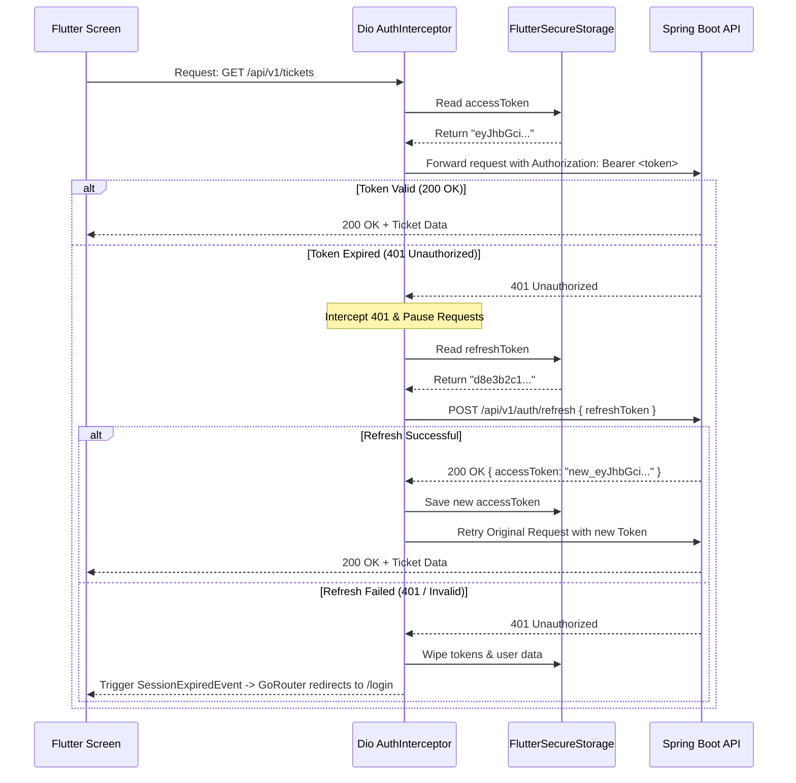

# 07. Flutter Architecture & Web-to-Mobile Mapping

## 1. Web-to-Mobile Transition Analysis

### 1.1 Web-Only Features to Drop or Replace

| Web Feature | Why Dropped / Replaced | Mobile Replacement Strategy |
| :--- | :--- | :--- |
| **Next.js Reverse Proxy Route (`/api/v1/[...path]`)** | Proxy was created to avoid browser CORS and hide internal Docker networking. | **Direct HTTP Calls**: Mobile client speaks directly to Spring Boot backend (`http://...:8080/api/v1/` or production Railway URL). |
| **Server-Side Rendering (SSR)** | Flutter is a client-side compiled native runtime. | Pre-rendered splash screen + reactive cached state. |
| **SEO Metadata & OpenGraph** | Mobile apps are not indexed by web search engine crawlers. | Completely drop Next.js metadata objects. |
| **Browser `localStorage` & Cookies** | Plaintext, unencrypted browser storage insecure for JWTs. | **`flutter_secure_storage`** (uses iOS Keychain & Android EncryptedSharedPreferences). |
| **Next/Image Optimization Pipeline** | Next.js server-side WebP/AVIF image resize engine. | **`cached_network_image`** with disk cache and thumbnail generation. |
| **Mouse Hover & Keyboard Events** | Touch screen devices have no cursor hover states or physical Enter key defaults. | Replace hover with long-press or tap; configure `TextInputAction.send` on virtual keyboards. |
| **NextTopLoader Bar** | Top-edge HTML horizontal progress indicator. | Native platform spinners / `LinearProgressIndicator` or skeleton loaders. |

### 1.2 Mobile-Only Features to Implement

1. **Push Notifications (Firebase Cloud Messaging)**: Replace manual polling or missing notifications with real-time push alerts when a ticket is assigned, accepted, commented on, or resolved.
2. **Native Camera & Gallery Access**: Direct hardware integration via `image_picker` allowing employees to snap photos of broken screens, cables, or server lights directly into the ticket form.
3. **Biometric Authentication**: Touch ID / Face ID unlock via `local_auth` so users don't have to re-enter email and password when opening the app.
4. **Pull-to-Refresh (`RefreshIndicator`)**: Standard mobile gesture to refetch ticket lists and dashboard stats.
5. **Network Connectivity & Offline Awareness**: Monitor connection state using `connectivity_plus` to alert users when the backend is unreachable.
6. **Haptic Feedback**: Subtle vibration on ticket submission, status updates, or message sends (`HapticFeedback.lightImpact()`).

---

## 2. Recommended Flutter Architecture & Packages

### 2.1 Recommended Package Ecosystem

| Functional Concern | Selected Package | Version Recommendation | Justification |
| :--- | :--- | :--- | :--- |
| **State Management** | `flutter_riverpod` + `riverpod_annotation` | `^2.6.1` | Compile-safe dependency injection, seamless auto-dispose caching, family providers for filtered queries. |
| **Declarative Routing** | `go_router` | `^14.6.2` | Clean declarative routing, deep linking support, reactive redirect guards based on Riverpod auth state. |
| **HTTP Client** | `dio` | `^5.7.0` | Robust interceptors for Bearer token injection, 401 token refresh queue, file upload progress tracking. |
| **Secure Storage** | `flutter_secure_storage` | `^9.2.2` | Hardware-backed key-value storage for access and refresh tokens. |
| **JSON Models & Immutability** | `freezed` & `json_serializable` | `freezed: ^2.5.7`, `json_annotation: ^4.9.0` | Immutable data classes, union types for UI states, automatic JSON serialization. |
| **Real-time STOMP / WebSocket**| `stomp_dart_client` | `^1.0.1` | Native Dart STOMP protocol implementation over WebSockets for ticket live chat. |
| **Image Caching** | `cached_network_image` | `^3.4.1` | Efficient image disk caching, placeholder loaders, and thumbnail handling for attachments. |
| **Device Media Picker** | `image_picker` | `^1.1.2` | Native iOS/Android picker for camera and photo library. |
| **Form Handling** | `reactive_forms` or native `Form` | Native or `reactive_forms: ^17.0.0` | Typed form validation matching the web app's requirements. |
| **Date & Time Formatting** | `intl` | `^0.19.0` | Date formatting with timezone offset support. |

---

## 3. Recommended Project Folder Structure (Feature-First)

```
lib/
├── app/
│   ├── app.dart                   # MaterialApp.router configuration
│   ├── constants/                 # App-wide constants (endpoints, colors, asset paths)
│   ├── routes/                    # GoRouter definition and AuthGuard redirect logic
│   └── theme/                     # ThemeData, Satoshi fonts, color schemes
├── core/
│   ├── network/
│   │   ├── api_client.dart        # Dio singleton with base options
│   │   ├── auth_interceptor.dart  # Automatic Bearer token & 401 refresh handler
│   │   └── websocket_client.dart  # STOMP client manager
│   ├── storage/
│   │   └── secure_storage.dart    # Token & credential persistence wrapper
│   └── utils/
│       ├── date_formatter.dart    # Asia/Phnom_Penh timezone conversions
│       └── formatters.dart        # Compact number formatters
├── features/
│   ├── auth/
│   │   ├── data/                  # AuthRepository, AuthRemoteDataSource
│   │   ├── domain/                # User, LoginRequest, AuthTokens models
│   │   └── presentation/          # LoginScreen, authController (Riverpod)
│   ├── dashboard/
│   │   ├── data/                  # DashboardRepository (stats, charts)
│   │   ├── domain/                # DashboardStats, MonthlyStats models
│   │   └── presentation/          # DashboardScreen, KpiCardsGroup, TrendChart
│   ├── incident_catalog/
│   │   ├── data/                  # CategoryRepository
│   │   ├── domain/                # Category, SubCategory models
│   │   └── presentation/          # CatalogScreen, IncidentListScreen
│   ├── tickets/
│   │   ├── data/                  # TicketRepository, ImageUploadRepository
│   │   ├── domain/                # Ticket, ChatMessage, CreateTicketDto
│   │   └── presentation/
│   │       ├── screens/           # TicketListScreen, TicketDetailScreen, CreateTicketScreen
│   │       ├── widgets/           # TicketCard, StatusBadge, PriorityBadge
│   │       └── controllers/       # TicketListNotifier, TicketChatNotifier
│   ├── user_management/           # Admin only
│   │   ├── data/                  # UserRepository, DepartmentRepository
│   │   ├── domain/                # UserResponse, CreateUserDto, Department
│   │   └── presentation/          # UserListScreen, AddUserScreen, EditUserScreen
│   └── profile/
│       ├── data/                  # ProfileRepository
│       └── presentation/          # ProfileScreen, SettingsScreen
└── shared/
    └── widgets/                   # AppButton, AppTextField, AppBadge, AppBottomSheet
```

---

## 4. Mobile Authentication & Interception Architecture



---

## 5. Required Backend Adaptations for Mobile

To support a production-grade Flutter mobile app, the following Spring Boot backend considerations must be addressed:

1. **Elimination of Next.js Proxy & Direct CORS Configuration**:
   The web application leveraged Next.js route handlers (`src/app/api/v1/[...path]/route.ts`) to avoid browser CORS. Mobile apps make requests directly to the Spring Boot origin. Ensure the backend `SecurityConfig` or `WebMvcConfigurer` allows mobile user agents and handles preflight requests without restrictive origin checks.
2. **Server-Side Pagination & Query Filtering**:
   Currently, endpoints `GET tickets`, `GET tickets/my`, and `GET users` return unpaginated lists that the web app paginates in-memory. The backend should support standard Spring Data pagination parameters (`?page=0&size=15&sort=createdAt,desc`) and filtering (`?status=PENDING&search=...`) to avoid transmitting thousands of records over mobile cellular networks.
3. **STOMP WebSocket Handshake Authentication**:
   Verify whether `/ws-chat` accepts Bearer tokens in STOMP headers:
   ```dart
   stompClient = StompClient(
     config: StompConfig(
       url: 'ws://$baseUrl/ws-chat',
       stompConnectHeaders: {'Authorization': 'Bearer $token'},
     ),
   );
   ```
4. **Push Notification Device Token Endpoint**:
   Add an endpoint such as `POST /api/v1/users/device-token` so the mobile app can register its Firebase Cloud Messaging (FCM) or Apple APNs device token for background push alerts.
5. **Implementation of True Ticket Update Endpoint (`PUT /api/v1/tickets/{id}`)**:
   Provide a standard endpoint for editing ticket descriptions and attachments if regular users need to edit pending tickets.
